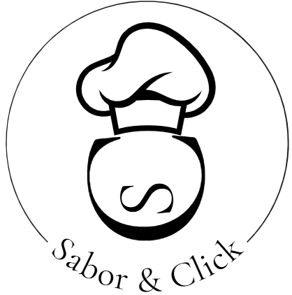

<a id="readme-top"></a>
<!-- PROJECT LOGO -->
<br />
<div align="center">
  <a href="https://github.com/Sophia-sQ/Sabor-Click">
    
  </a>
<h3 align="center">Sabor & Click</h3>
<p align="center">
    Aluguel de serviços culinários.
    <br />
    <a href="https://github.com/Sophia-sQ/Sabor-Click/tree/main/docs"><strong>Veja a documentação »</strong></a>
    <br />
    <br />
  </p>
</div>

<!-- TABLE OF CONTENTS -->
<details>
  <summary>Sumário</summary>
  <ol>
    <li>
      <a href="#about-the-project">Sobre o Projeto</a>
      <li><a href="#built-with">Construído com</a></li>
    </li>
        <li><a href="#prerequisites">Pré-requisito</a></li>
        <li><a href="#installation">Instalação</a></li>
    <li><a href="#inicializacao">Inicialização</a></li>
    </li>
    <li><a href="#license">License</a></li>
    <li><a href="#contact">Contact</a></li>
  </ol>
</details>

<!-- ABOUT THE PROJECT -->
### Sobre o projeto <p id="about-the-project"></p>
O Sabor e Click é um projeto acadêmico, realizado por Rafaella, Kleber, Sophia e Thiago.
Ele consiste em um sistema de aluguel de diferentes serviços culinários, na qual cada serviço possui seus próprios cardápios com entrada, prato principal, acompanhamento e sobremesa. Ele não só é um sistema para utilização do cliente, mas também chefs e o admin possuem suas próprias páginas para observar os pedidos e relatórios da empresa.
<p align="right">(<a href="#readme-top">para o início</a>)</p>

### 🛠️ Construído com


<p align="right">(<a href="#readme-top">para o início</a>)</p>

### Pré-requisitos
#### LINUX
* python
```sh
sudo apt install python3 python3-pip python3-venv -y
  ```

#### Windows
* python
```sh
winget install Python.Python.3.15
  ```
<p align="right">(<a href="#readme-top">para o início</a>)</p>

### 🔧 Instalação
A seguir será mostrado passo a passo de como rodar o projeto e os pré-requisitos necessário
Clone o repositório
```sh
git clone https://github.com/Sophia-sQ/Sabor-Click.git
   ```
Acesse o diretório do projeto.
```sh
cd Sabor-Click
```

#### LINUX
Crie e ative o ambiente virtual
```sh
python -m venv venv
python source/bin/activate
```
Instale pré-requisitos
```sh
pip install python
pip install -r requirements.txt
pip install flask
```

#### WINDOWS
Crie e ative o ambiente virtual
```sh
python -m venv venv
venv\Scripts\Activate
```
Instale pré-requisitos
```sh
pip install python
pip install -r requirements.txt
pip install flask

```
<p align="right">(<a href="#readme-top">para o início</a>)</p>

#### Inicialização: 
Popule o banco de dados
```sh
flask seed
```
Rode a aplicação
```sh
python app.py
```
Acesso é feito pelo <a href="127.0.0.1:5000">localhost</a> na porta 5000 (padrão do framework)
<p align="right">(<a href="#readme-top">para o início</a>)</p>

## ✒️ Autores

* **Sophia Sales**  - [github](https://github.com/Sophia-sQ)
* **Rafaella de Souza** - [github](https://github.com/Rafa-Santanna)
* **Kleber da Silva**  - [github](https://github.com/kleber288)
* **Thiago Vinícius**  - [github](https://github.com/Th1ago-V)
<p align="right">(<a href="#readme-top">para o início</a>)</p>

<!-- LICENSE -->
## 📄 Licença

Distribuido atráves da licença MIT. Veja `LICENSE` para mais informações.
<p align="right">(<a href="#readme-top">para o início</a>)</p>
